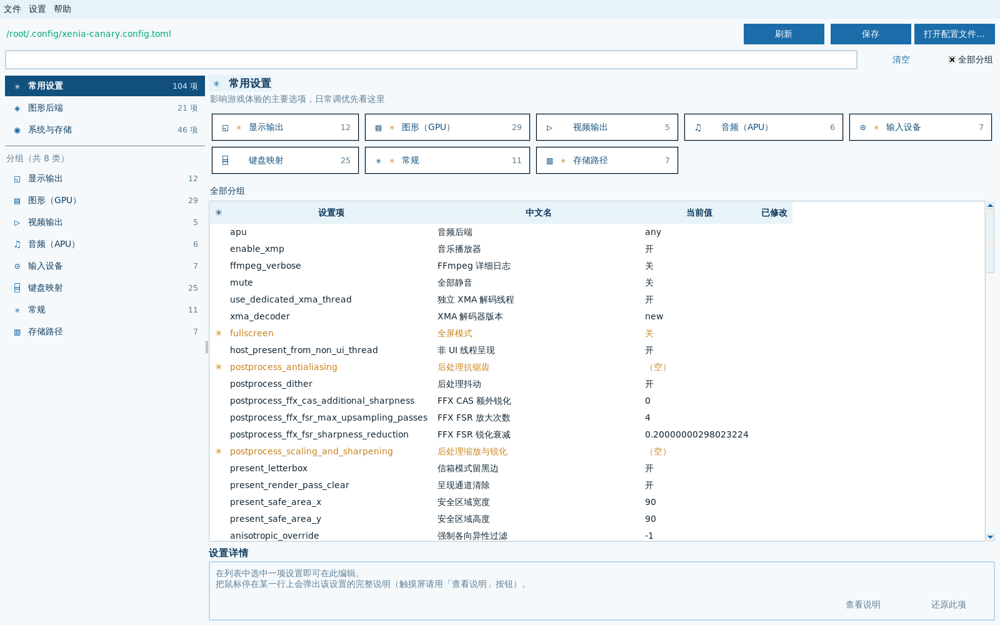
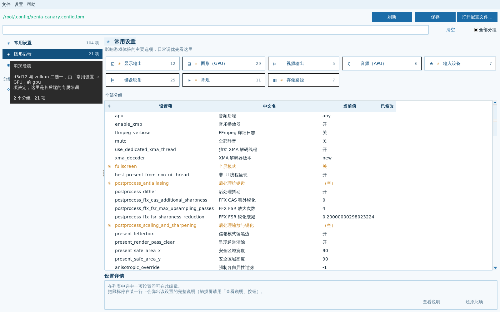

# Xenia Canary 配置工具

图形化编辑 `xenia-canary.config.toml` 的 Linux 桌面工具，交付形式为 **单文件 AppImage**。

Xenia Canary 有 **267 项设置**，官方配置文件是一份 553 行的 TOML，靠手改容易改错、
改坏格式，也看不清每一项到底干什么。本工具把这些设置整理成分类导航 + 列表 +
详情面板，改完**只替换你动过的那一行**，注释和排版原样保留。

为 **SteamOS / Linux 掌机**设计：Wayland 原生运行（含游戏模式的 gamescope 合成器），
界面随窗口尺寸与系统缩放自适应（800×600 到 4K 全屏、100%~200% DPI 均可），
**自带字体与 Python 运行时**，拖进 U 盘即可用，不依赖宿主系统的任何组件。

---

## 界面



左栏四大类导航（常用设置 / 图形后端 / 系统与存储 / 开发者选项），中间是分组卡片与设置列表，
下方是当前选中项的详情与编辑区。列表右侧「已修改」列会标出你改过但还没保存的项。

导航条目、分组卡片、列表行都支持**悬停查看说明**：



---

## 快速开始

```bash
chmod +x XeniaCanaryConfigTool-1.0.0-x86_64.AppImage
./XeniaCanaryConfigTool-1.0.0-x86_64.AppImage
```

程序启动时会自动探测配置文件位置，按以下顺序查找：

| 顺序 | 位置 | 说明 |
|---|---|---|
| 1 | 可执行文件同目录（存在 `portable.txt` 时） | xenia 便携模式 |
| 2 | `$XDG_CONFIG_HOME/xenia-canary.config.toml` | 默认即 `~/.config/` |
| 3 | `~/.local/share/xenia-canary/xenia-canary.config.toml` | 常见安装位置 |
| 4 | `~/xenia-canary.config.toml` | 家目录直放 |
| 5 | `/usr/share/xenia-canary/xenia-canary.config.toml` | 系统级安装 |
| 6 | `~/.steam/steam/steamapps/compatdata/*/pfx/.../AppData/Roaming/` | Proton 兼容层前缀 |
| 7 | `~/.local/share/Steam/steamapps/compatdata/*/pfx/.../AppData/Roaming/` | 同上（另一安装路径） |

没找到也不要紧——点「打开配置文件…」手动选择即可，程序会记住你选的路径。

> 程序**不接受命令行参数**指定配置路径；需要手动指定时用界面上的「打开配置文件…」。

### SteamOS / Steam Deck 上使用

**桌面模式**：双击运行，或在终端里执行上面的命令。

**游戏模式**：把它作为「非 Steam 游戏」添加到库中：

1. 桌面模式下打开 Steam → 游戏 → 添加非 Steam 游戏
2. 选择该 AppImage 文件
3. 在属性的「兼容性」中可选强制使用 Proton（本程序不需要，留空即可）
4. 回到游戏模式启动

程序会检测 gamescope 环境并选择合适的显示后端。若你的 Deck 上运行异常，
可以设置环境变量 `XENIA_CONFIGTOOL_DEBUG=1` 查看诊断日志。

---

## 功能

| 功能 | 说明 |
|---|---|
| 全量覆盖 | 23 个分组、267 项设置，与官方配置文件一一对应 |
| 分类导航 | 按「常用设置 / 图形后端 / 系统与存储 / 开发者选项」四大类组织 |
| 中文名列 | 每项都有中文短名（仅中文界面显示），不用再猜 `postprocess_ffx_fsr_max_upsampling_passes` 是什么 |
| 悬停说明 | 鼠标停在任意设置行上即显示完整官方说明，不占用界面空间；触摸屏长按同样有效 |
| 智能编辑 | 布尔值用开关、枚举值用下拉框、数值项显示范围与默认值 |
| 搜索 | 同时搜索设置名、分组名、中文名与说明正文（都是小写不敏感的子串匹配），中文关键词直接命中 |
| 中英双语 | 菜单「设置 → 语言」可实时切换，选择会被记住 |
| 掌机预设 | 内置 Steam Deck / 均衡 / 画质优先三档推荐值，确认后一次性套用 |
| 原地覆盖 | 保存时写回原文件，并自动生成带时间戳的 `.bak` 备份 |
| 格式保全 | 只改动被编辑的那一行，注释、顺序、对齐方式原样保留 |
| 变更追踪 | 已修改项在列表中标记，可逐项还原或整体恢复默认 |
| 后端感知 | `gpu` 选 d3d12 时自动隐藏 Vulkan 专属项，反之亦然 |
| 选中高亮 | 当前分组卡片用浅蓝底 + 深色加粗字 + 蓝色描边标出 |
| 计数如实 | 卡片与左栏显示的数字是**当前视图真正能列出的条数**，不是配置文件里的总数 |
| 自适应布局 | 左栏宽度、列表列宽、卡片列数全部随窗口尺寸与 DPI 实时重算 |
| 自带字体 | 内嵌 DejaVu + 文泉驿微米黑，宿主无字体也能正常显示 |
| 启动最大化 | 启动即铺满屏幕，两百多条设置一次能看更多 |
| 前向兼容 | 配置里出现工具不认识的新项时原样保留，不会丢失 |

### 中文名列

只有中文界面会多出「中文名」这一列，英文界面不显示（英文用户看官方原文即可）。

```
设置项                              中文名            当前值      已修改
apu                                 音频后端          any
postprocess_antialiasing            后处理抗锯齿      （空）
postprocess_scaling_and_sharpening  后处理缩放与锐化  （空）
```

### 界面布局

```
┌──────────┬────────────────────────────────────────────┐
│ ✳ 常用   │  ✳ 常用设置                                │
│ ◈ 图形   │  ┌──────┐┌──────┐┌──────┐┌──────┐          │
│ ◉ 系统   │  │显示  ││图形  ││视频  ││音频  │  分组卡片 │
│ ⊘ 开发者 │  └──────┘└──────┘└──────┘└──────┘          │
│          │  图形（GPU）                               │
│ 分组列表 │  *  设置项              当前值      已修改   │
│  显示(12)│  *  draw_resolution_x   1                  │
│  图形(30)│  *  gpu                 vulkan             │
│          │  ← 悬停看说明                              │
│          │  设置详情  [编辑控件]  [查看说明][还原此项] │
└──────────┴────────────────────────────────────────────┘
```

窗口**启动时自动最大化**，铺满整个屏幕 —— 设置项有两百多条，窗口越大一次
能看到的条目越多。不同桌面环境对最大化的支持写法不一，程序会依次尝试
`state("zoomed")`、`-zoomed`、`-fullscreen`，并在 180ms 后回查实际尺寸；
若窗口管理器静默忽略，则直接设成屏幕尺寸兜底。Bazzite/GNOME（2880x1620）
实测启动即满屏。手动缩放窗口后布局会实时重算，不会残余旧尺寸。

左栏宽度取窗口宽度的 20%（钳制 220–340px），主区始终保底 560px。
列表列宽全部按**当前字体的实测像素宽度**计算：行高取字体行距 + 8px，
「已修改」列按表头文字实测宽度分配，因此在高 DPI（150%/200%）下同样完整显示，
不会出现文字叠行或末列被裁。

### 图形后端：d3d12 与 vulkan 不是两个并列的选项

这是最容易误解的一点。**`gpu` 是 `[GPU]` 段里的一个设置项，取值可以是
`d3d12` / `vulkan` / `any` / `null`** —— 它是「选哪个后端」，不是两个独立开关。

工具据此做了两件事：

- 「图形后端」大类下的 **D3D12 / Vulkan 分组只显示当前选中后端的那一个**。
  `gpu` 设成 `vulkan` 时，D3D12 分组自动隐藏；设成 `d3d12` 时 Vulkan 分组隐藏；
  设成 `any`（自动）时**两个都显示**，因为它可能落到任一边。
- `render_target_path_d3d12` / `render_target_path_vulkan` 这两项在 TOML 里其实
  属于 `[GPU]` 段，但对用户来说是「各后端的专属项」。工具把它们**额外挂到**对应的
  后端分组下，原分组仍然保留，因此你在「图形后端 → Vulkan」里也能找到它，搜索同样能命中。

### 掌机预设

菜单「设置 → 掌机预设」提供三档，选中后**先弹出确认对话框列出将被修改的项**，
确认才写入：

| 预设 | 主要改动 |
|---|---|
| Steam Deck / 掌机（720p 省电） | `gpu=vulkan`、1x 缩放、垂直同步开、限帧 30、异步着色器编译 |
| 均衡（2x 分辨率缩放） | `gpu=vulkan`、2x 缩放、垂直同步关、限帧 60 |
| 画质优先（3x + 锐化） | `gpu=vulkan`、3x 缩放、FSR 缩放锐化、不限帧 |

---

## 快捷键

| 按键 | 功能 |
|---|---|
| `Ctrl+O` | 打开配置文件 |
| `Ctrl+S` | 保存 |
| `Ctrl+Shift+S` | 另存为 |
| `Ctrl+F` | 聚焦搜索框 |
| `F5` | 重新载入 |
| `Ctrl+Q` | 退出 |
| `Esc` | 清空搜索 / 关闭对话框 |

---

## 保存行为

保存有**两道确认**：先弹出对话框显示目标路径与改动项数，确认后才写入。
写入流程：

1. 用 `tomllib` 校验渲染结果仍是合法 TOML（防止写出坏文件）
2. 在原文件同目录生成 `xenia-canary.config.toml.<时间戳>.bak` 备份
3. 写临时文件后原子替换，避免写入中断导致文件损坏

备份可在「设置 → 保存前自动备份」中关闭（默认开启）。

### 格式保全

工具采用行级编辑而非整体重写，因此：

- 你自己的注释、空行、分组顺序都会保留
- 只有被改动的行会变化，`diff` 结果干净
- 未改动的 267 项中，任何一项都不会被意外改动

已验证：读入原始配置再序列化，可**逐字节完全一致**（`tools/test_e2e.py` 第 [1] 项）。

---

## 关于「某某分组显示 0 项」

「内核模拟」「日志」这类分组在「系统与存储」下会显示 **橙色 0**，这是正常的：

这两个分组里的设置（如 `log_level`、`log_file`、`kernel_cert_*`）全部属于**高级选项**，
默认视图中被隐藏，只有切到「开发者选项」大类才会出现。
267 项中有 **132 项属于高级选项**，其中 `CPU`(43)、`GPU.Debug`(31)、`Kernel`(16)、
`x64`(13)、`Logging`(12)、`Memory`(6) 是**整组都是高级项**。

点进这类分组时，列表上方会有一条说明，右侧带「**前往开发者选项**」按钮，点一下就直接跳过去。
想在任何视图里都看到高级选项，也可以勾选菜单「设置 → 显示高级选项」。

> 卡片上的数字始终等于**点进去实际能看到的条数**，所以看到 0 就代表这组当前确实为空，
> 不会出现「写着 16 项、点进去一条都没有」的情况。
> 这一条由测试第 [10] 项遍历全部 22 个分组断言钉死。

---

## 响应速度

切换分组（点左栏的「显示(12)」这类条目）会重算列表内容、列宽和卡片角标。
程序对这些做了复用优化：分组卡片区的内容在切分组时并没有变化，因此不再
重建；「已修改」角标只就地改一个 Label 的颜色，而不是重画整片卡片区。

---

## 从源码运行

```bash
python3 src/app.py
```

需要 Python 3.11+ 与 `tkinter`。Debian/Ubuntu 上若缺 tkinter：

```bash
sudo apt install python3-tk
```

### 构建 AppImage

```bash
bash packaging/build.sh
```

产物在 `dist/`。构建脚本会把宿主 Python、标准库、Tcl/Tk 运行时与所需共享库
（25 个 `.so`，含 `libtk8.6` / `libtcl8.6` / X11 与字体栈）一并打包进 AppImage，
因此生成的 AppImage 在 SteamOS 这类不可变系统上也能直接运行。

> 容器或无 FUSE 环境下，脚本会自动改用 `--appimage-extract-and-run`。

构建脚本会把字体（`DejaVuSans*.ttf` + `wqy-microhei.ttc`，约 7MB）一并打包，
AppRun 启动时通过临时 fontconfig 配置注册它们，因此即使目标系统一个字体都没有
（精简版 SteamOS、容器等），界面也能正常渲染。

---

## 项目结构

```
├── src/
│   ├── app.py              主程序与界面（2231 行）
│   ├── theme.py            海蓝色主题、字体选择、行高实测
│   ├── navmeta.py          分类导航元数据、后端依从规则、掌机预设
│   ├── i18n.py             界面文案与双语资源加载
│   ├── tooltip.py          悬停提示组件（含 Treeview 行级提示）
│   ├── toml_edit.py        保留格式的行级 TOML 编辑器
│   ├── settings_store.py   本工具偏好持久化
│   └── data/
│       ├── schema.json          267 项设置的元数据（分组/类型/默认值/原始注释）
│       ├── desc_zh.json         267 条中文说明
│       ├── names_zh.json        267 条中文短名
│       └── xconfig_choices.json 账号国家(107) / 语言(16) 枚举
├── packaging/
│   ├── build.sh            构建脚本（含运行时捆绑）
│   ├── AppRun              AppImage 入口（显示后端探测、字体注册）
│   ├── *.desktop           桌面入口
│   └── *.appdata.xml       AppStream 元数据
├── tools/                  开发与验证脚本
├── assets/icons/           多尺寸图标（16 到 512）
├── reference.config.toml   官方参考配置，schema 的数据来源
└── plan/worklogs/          开发工作日志
```

---

## 开发与验证

```bash
# 端到端测试（41 项断言，走 Xvfb，不需要真实显示器）
python3 tools/test_e2e.py

# 后端依从规则可见性验证
bash tools/test_dependency.sh

# AppImage 产物验证：解包完整性 + 捆绑解释器独立启动 + 隔离环境 GUI 启动
bash tools/verify_appimage.sh
```

`tools/test_e2e.py` 覆盖：往返一致性、schema 与配置同步、写入最小性、语法有效性、
前向兼容（未知项保留）、双语资源完整性、枚举与范围元数据、预设有效性、
导航分类元数据，以及**卡片计数与实际列出条数的一致性**。

### 数据管线

`schema.json` 由 `tools/extract_schema.py` 从 `reference.config.toml` 抽取，
再由 `tools/build_schema.py` 生成。中文短名由 `tools/names_zh.py` 逐条人工撰写
（**不是机器翻译**），经 `tools/build_names.py` 合成。账号国家/语言枚举由
`tools/build_xconfig.py` 生成。

> ⚠️ **`reference.config.toml` 与 `schema.json` 必须保持同步。**
> 界面按 schema 渲染，而列表填充时会硬过滤掉配置里不存在的项。
> 若两者不同步，会出现「schema 里有、界面不显示」的情况。测试第 [2] 项会检查这一点。

---

## 已知限制

- `[Win32]` 分组的两项设置仅对 **Windows 版 xenia** 生效，Linux 下改了没有效果
  （界面里该分组有明确提示）。
- 部分设置需要**重启 xenia** 才生效，工具无法代劳。
- 工具不认识的新版本设置项会**原样保留在文件里**，但界面中不可编辑。
  要支持它们需要更新 `schema.json`。
- 程序启动时自动探测配置路径，**不支持命令行参数**指定。
- 保存前会双重确认，没有「静默保存」选项。
